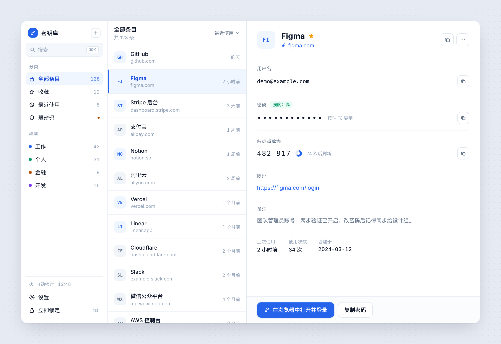
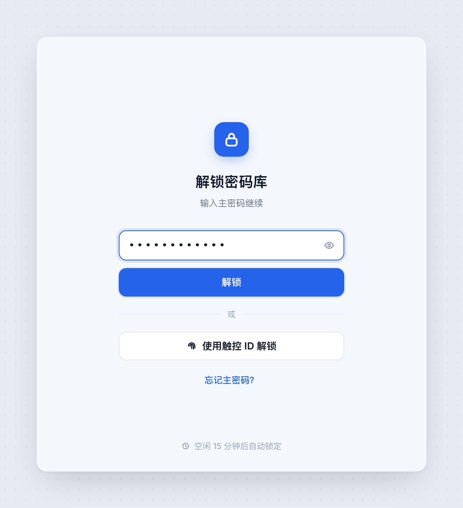
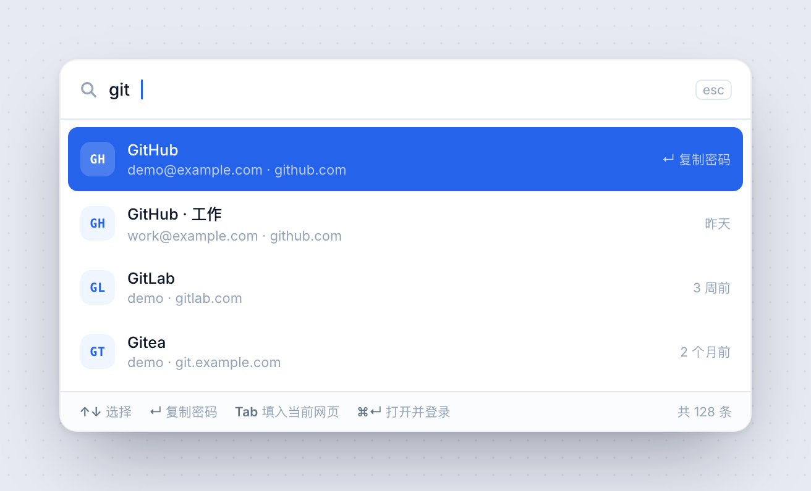
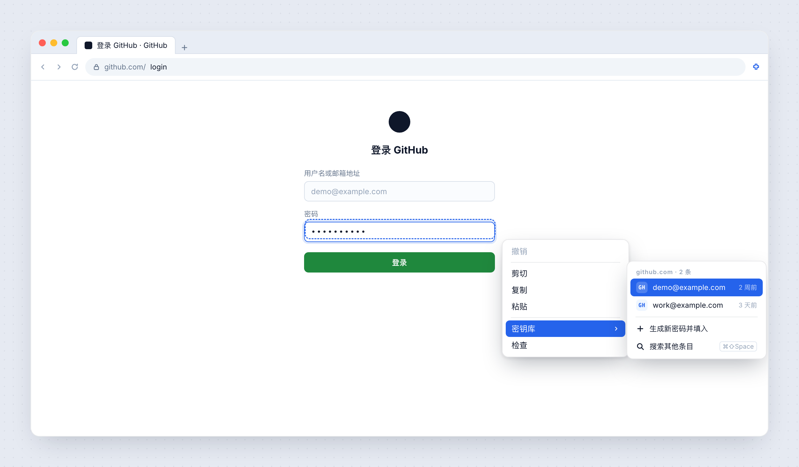
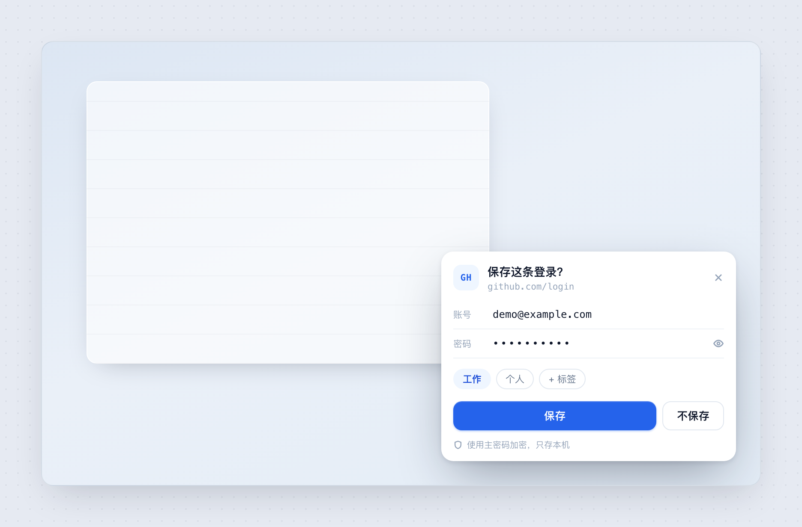
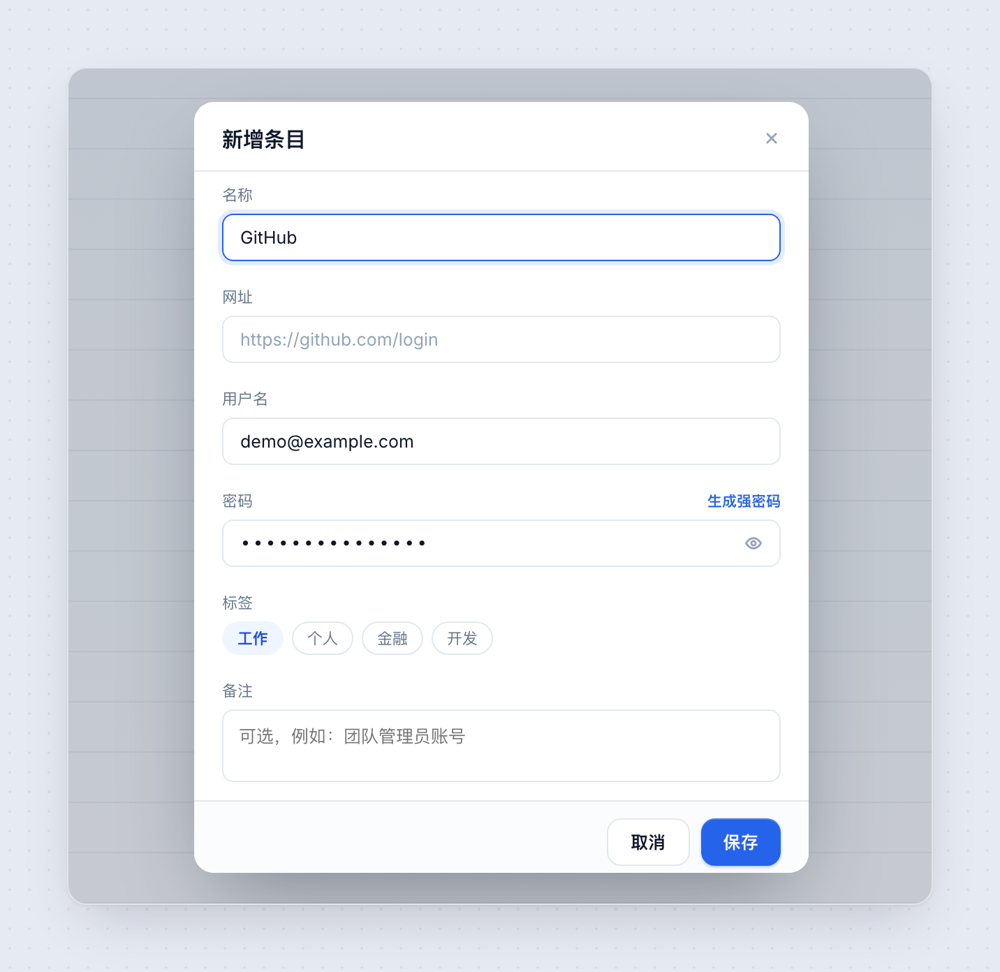
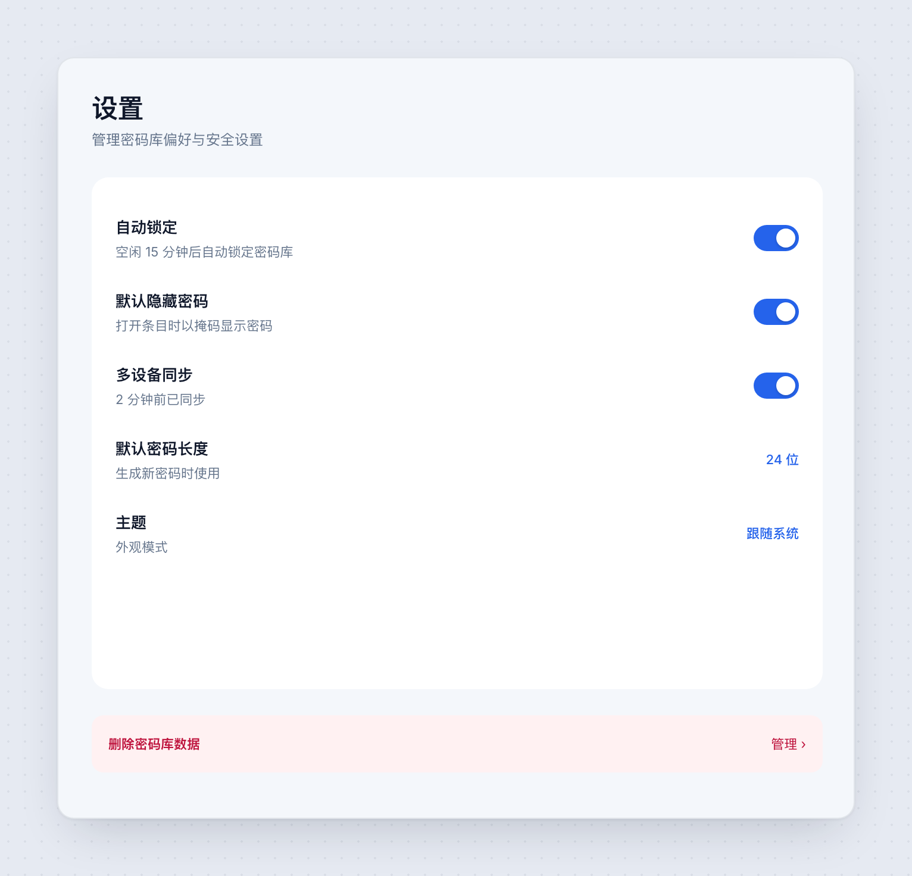

# 密钥库 · Keylite

**macOS 上本地优先的账号密码管理工具。** 一个桌面应用 + 一个浏览器扩展，零云端。

数据只存在你这台 Mac 上，密码字段用 AES-256-GCM 加密，主密码本身不落盘。
浏览器里点进输入框就能看到本站账号，选中即填；提交登录后自动保存，网页上提示并可撤销。

```
Rust 内核 + Tauri 2 桌面端 + Chrome MV3 扩展
打包体积约 6.5 MB（Electron 同类应用通常 150 MB+）
```

## 下载

从 [Releases](https://github.com/liupurui/keyLite/releases) 下载 `Keylite_*_universal.dmg`
（通用二进制，Apple 芯片与 Intel 都能跑）。

> **首次打开需右键 → 打开**：项目尚未申请 Apple Developer ID 证书，未经 Apple 公证，
> 系统会提示「无法验证开发者」。也可以在「系统设置 → 隐私与安全性」中放行，
> 或者直接[从源码构建](#快速开始)。

---

## 为什么需要两个进程

桌面应用**无法**读取浏览器里的网页内容——这是浏览器的安全沙箱，不是能力缺陷。
所以「自动识别登录框、一键填充」只能由扩展完成，扩展再通过 Native Messaging 与本机应用通信。

```
┌──────────────────────────┐         ┌─────────────────────────────┐
│  密钥库.app（Tauri）      │         │  密钥库扩展（Chrome MV3）    │
│  ├ 主窗口 / 菜单栏图标    │◄───────►│  ├ 识别登录框                │
│  ├ Rust 加密内核          │ Native  │  ├ 右键菜单 / 内联钥匙按钮   │
│  ├ SQLite（密文）         │ Messa-  │  ├ 自动保存与页面内提示      │
│  └ 触控 ID / 钥匙串       │ ging    │  └ 执行填充                  │
└──────────────────────────┘         └─────────────────────────────┘
```

## 界面

**密码库主界面** —— 分类 / 条目 / 详情三栏，域名首字母色块做识别



<table>
<tr>
<td width="50%"><b>解锁</b><br>主密码 + 触控 ID 双入口<br></td>
<td width="50%"><b>快速搜索 ⌘⇧Space</b><br>↑↓ 选择、↵ 复制密码<br></td>
</tr>
<tr>
<td><b>浏览器右键 · 一键登录</b><br>按站点过滤，按最近使用排序<br></td>
<td><b>保存提示</b><br>提交后自动保存，6 秒内可撤销<br></td>
</tr>
<tr>
<td><b>新增条目</b><br>密码框右侧直接给生成入口<br></td>
<td><b>设置</b><br>保存方式、触控 ID、菜单栏、清空密码库<br></td>
</tr>
</table>

完整设计板：[`docs/screens/00-all-screens.png`](docs/screens/00-all-screens.png)　｜　
可交互原型：[`docs/mockups.html`](docs/mockups.html)（浏览器直接打开，1:1 真实像素）

重新导出（需要本机 Chrome）：

```bash
bash scripts/shoot.sh   # 产物在 docs/screens/
```

## 功能

**桌面端**

- 主密码解锁、**触控 ID 解锁**、⌘L 立即锁定、空闲自动锁定（可关）
- 三栏主界面：分类 / 标签 / 条目列表 / 详情
- 条目增删改、**内置 TOTP 两步验证码**（每秒刷新 + 倒计时）
- 密码生成器（可配长度与字符类）
- **⌘⇧Space 全局搜索**：独立无边框窗口，置顶、失焦自动收起，↑↓ 选择、↵ 复制密码
- **深色主题**：跟随系统 / 浅色 / 深色，原生标题栏同步
- 复制密码后延迟清空剪贴板（只清自己复制的那次）
- **菜单栏常驻**：关窗口不退出，浏览器扩展照常工作；图标可开关
- 设置：保存方式、剪贴板、密码长度、菜单栏、清空密码库（主密码二次确认）

**浏览器扩展**

- **内联钥匙按钮**：点进账号或密码框，右侧浮出小钥匙，列出本站全部账号，选中即填
- 右键子菜单填充（按最近使用排序）
- **提交登录后自动保存**，页面右下角提示「已自动保存：站点」，6 秒内可撤销
- 密码冲突不静默覆盖，页面弹「更新密码？/ 保持原样」
- 兼容 React / Vue 受控输入；覆盖 form 提交、按钮点击、回车、整页跳转、SPA 清空字段
- 防钓鱼：注册域（eTLD+1）严格匹配，`github.com.evil.cn` 拿不到 `github.com` 的条目

## 快速开始

### 1. 只想看界面（浏览器，不编译 Rust）

```bash
cd app && npm install && npm run dev
# 打开 http://localhost:1420
# mock 模式主密码：keylite
```

没有跑在 Tauri 里时自动使用内存 mock，界面完整可点，数据不落盘。

### 2. 跑真桌面应用

```bash
cd app
npm install
npm run tauri dev     # 首次编译 Rust 约 3-8 分钟
```

### 3. 打包

```bash
cd app && npm run tauri build
# 产物：app/src-tauri/target/release/bundle/{macos,dmg}/
```

### 4. 装浏览器扩展

```bash
# 1) Chrome → chrome://extensions → 开发者模式 → 加载已解压的扩展程序 → 选 extension/
#    复制卡片上的扩展 ID
# 2) 注册本机通道
bash extension/install-host.sh <扩展ID>
# 3) 启动桌面端并解锁 → 打开任意登录页 → 点进密码框 → 右侧小钥匙
```

详见 [`extension/README.md`](extension/README.md)。

## 安全设计

```
主密码 ──Argon2id(m=64MiB,t=3,p=4)──► KEK ──AES-GCM 解包──► DEK
                                                            │
                      每条记录 ──AES-256-GCM(DEK, 随机 nonce)──► 密文
```

- 主密码**不落盘**，只存 salt 与封装后的 DEK
- 改主密码只重新封装 DEK，不重写全库；锁定即内存清零
- 密文字段 AAD 绑定条目 id，防止密文在条目之间搬运
- 扩展取明文要求「已解锁 + 站点一致」，且只能由白名单扩展 ID 调起
- 项目代码中**没有任何网络请求**，数据不出本机

**如实披露的边界**：标题、网址、域名、账号是明文存储（为了搜索速度），
拿到数据库文件能看出注册过哪些网站、用什么账号，但**看不到任何密码**。
完整的威胁模型与残余风险见 [`docs/PRODUCT.md`](docs/PRODUCT.md)。

## 项目结构

```
Keylite/
├── core/               Rust 内核：加密 / 存储 / 生成器 / TOTP / 域名归一化 / 扩展协议
├── app/                Tauri 2 + React 19 桌面端
│   ├── src/            界面
│   └── src-tauri/      命令层、托盘、触控 ID、扩展 IPC 通道
├── extension/          Chrome MV3 扩展 + Native Messaging 安装脚本
├── docs/
│   ├── DESIGN.md       技术方案与选型
│   ├── PRODUCT.md      产品与技术说明（含用户体验、信息安全）
│   ├── mockups.html    7 屏高保真设计稿
│   └── screens/        shoot.sh 导出的 PNG
└── scripts/            图标生成、设计稿导出
```

## 数据位置

```
~/Library/Application Support/dev.keylite.app/
├── vault.db          条目、密文、KDF 参数、设置
├── vault.db-wal      SQLite 预写日志
├── ipc.sock          浏览器扩展通信通道（权限 0600）
└── bin/keylite-host  扩展调起的桥程序
```

备份：拷走 `vault.db` 即可，换机器只要记得主密码。
彻底卸载：删掉该目录 + `security delete-generic-password -s dev.keylite.app`。

## 开发

```bash
cargo test -p keylite-core      # 内核单元测试（47 个）
cd app && npx tsc --noEmit      # 前端类型检查
node scripts/make-icons.mjs     # 重新生成应用图标
bash scripts/shoot.sh           # 导出设计稿 PNG
```

## 状态

| 阶段 | 内容 | 状态 |
|---|---|---|
| M0 | 设计方案 + 7 屏设计稿 | ✅ |
| M1 | 加密内核、解锁、增删改查、生成器、TOTP、设置 | ✅ |
| M2 | 浏览器扩展、自动保存、内联填充、防钓鱼、触控 ID、后台运行 | ✅ |
| M3 | 深色主题、全局搜索独立窗口 ✅ / Safari 扩展 ⏳ | 🔨 |
| M4 | Windows / Linux 适配 | ⏳ |
| M5 | 多设备端到端加密同步 | ⏳ |

已知限制与后续规划见 [`docs/PRODUCT.md`](docs/PRODUCT.md) 第十节。

## 许可

[MIT](LICENSE)
